<div align="center">

# Nexus Commerce

Multi-tenant e-commerce platform with a Go modular-monolith API, Cloudflare Worker edge router, merchant operations console, and Next.js customer storefront.


[Features](#features) · [Screenshots](#screenshots) · [Architecture](#architecture) · [Engineering Handbook](docs/HANDBOOK.md) · [ADRs](docs/adr/)

<a href="docs/screenshots/hero.png">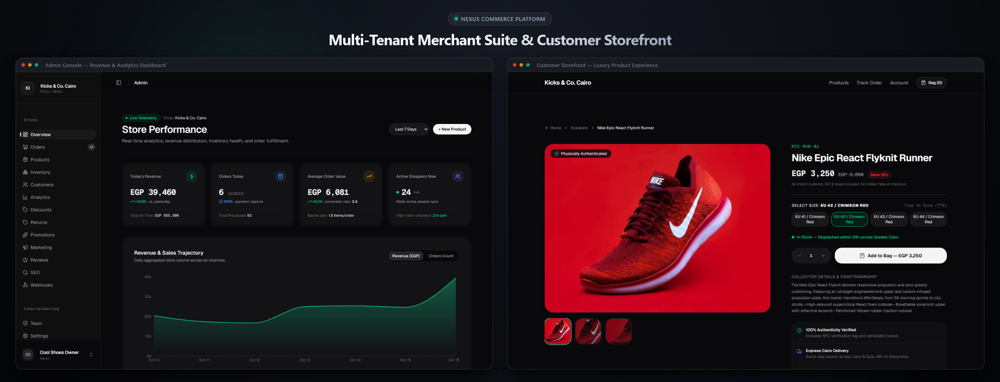</a>

</div>

---

## See it in action

<div align="center">

<a href="docs/demo.gif">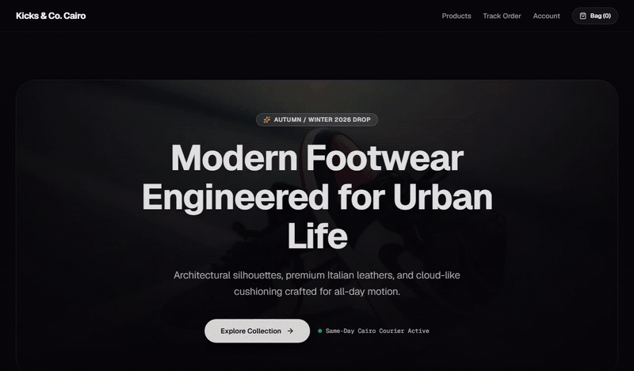</a>

Storefront product selection (`Aerocore 90s Heritage Trainer`, `EU 41`), cart drawer inspection, instant test-card checkout, and paid order `#1094` appearing in the merchant admin table.

</div>

---

## Screenshots

### Admin Console

<table>
  <tr>
    <td width="50%" valign="top">

<a href="docs/screenshots/01-admin-dashboard.png">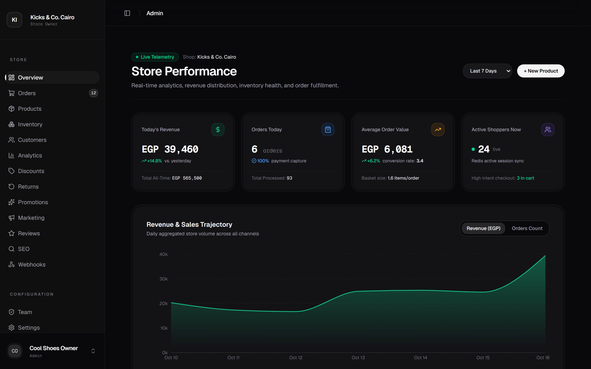</a>

**Store Overview** — Daily revenue (`EGP 39,460`), order volume (`6 orders`), average order value (`EGP 6,081`), active Redis sessions (`24 live`), and a 7-day sales trajectory chart.

</td>
    <td width="50%" valign="top">

<a href="docs/screenshots/04-orders-list.png">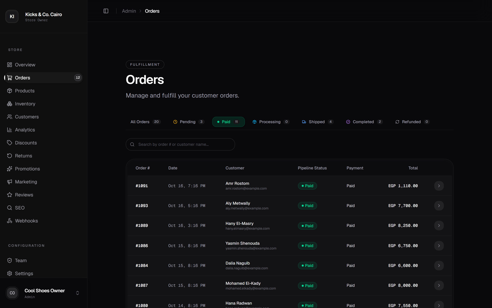</a>

**Order Pipeline** — Fulfillment queue filtered by status (`All Orders`, `Pending`, `Paid`, `Processing`, `Shipped`, `Completed`, `Refunded`) with customer emails and order totals.

</td>
  </tr>
  <tr>
    <td width="50%" valign="top">

<a href="docs/screenshots/03-product-edit.png">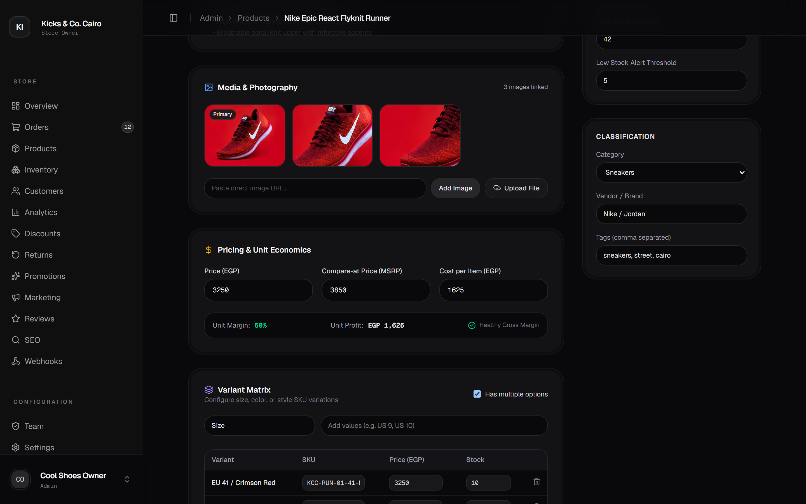</a>

**Product & Variant Editor** — Multi-image gallery manager, unit margin calculator (`50%` margin and `EGP 1,625` profit on `EGP 3,250` price), and size/color variant SKU table.

</td>
    <td width="50%" valign="top">

<a href="docs/screenshots/02-products-list.png">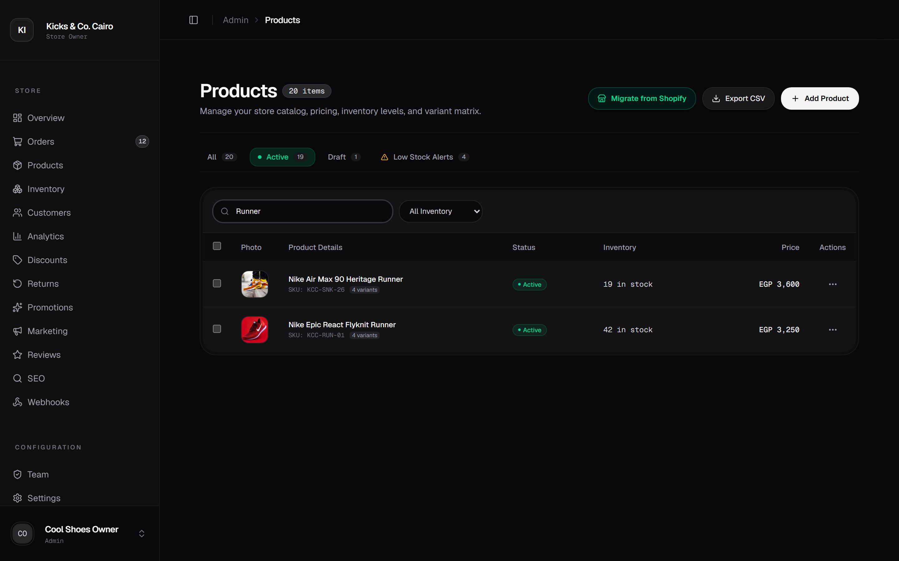</a>

**Catalog Directory** — Searchable product table (`"Runner"` filter applied) showing SKU codes, variant counts, stock quantities, status tabs, and CSV/Shopify import triggers.

</td>
  </tr>
</table>

### Customer Storefront

<table>
  <tr>
    <td width="50%" valign="top">

<a href="docs/screenshots/06-storefront-home.png">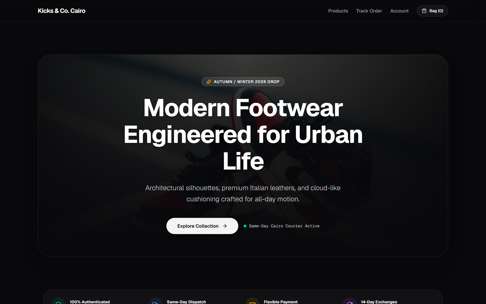</a>

**Storefront Home** — Tenant landing page (`Kicks & Co. Cairo`) with hero banner, collection call-to-action, and regional courier dispatch indicators.

</td>
    <td width="50%" valign="top">

<a href="docs/screenshots/08-product-detail.png">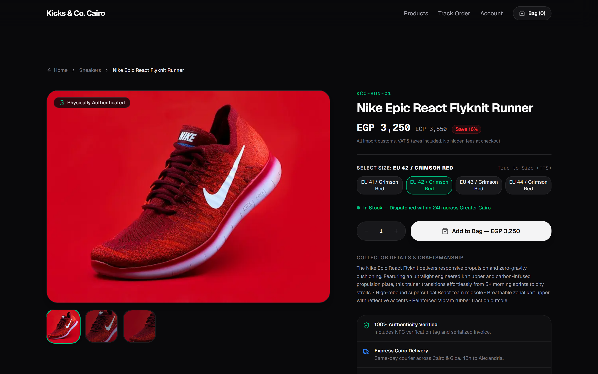</a>

**Product Detail** — Three-angle product gallery, discount badge (`Save 16%`), interactive EU size selector pills, stock availability indicator, and add-to-bag controls.

</td>
  </tr>
  <tr>
    <td width="50%" valign="top">

<a href="docs/screenshots/09-cart.png">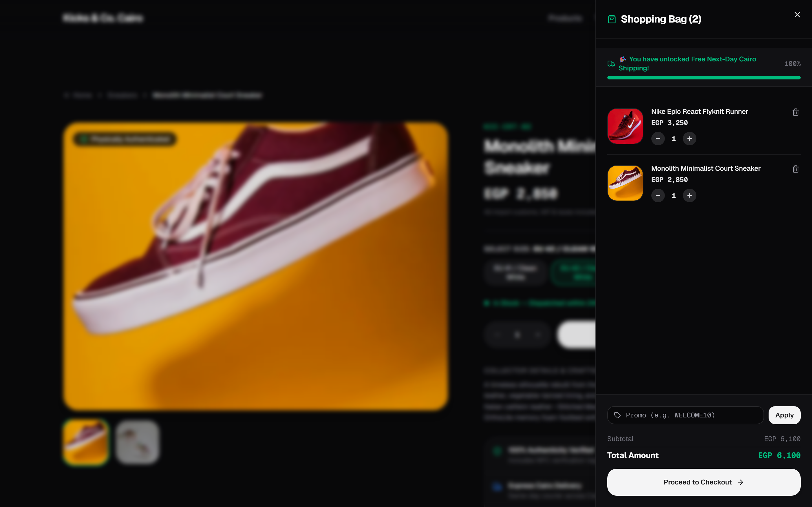</a>

**Slide-Over Shopping Bag** — Cart drawer showing two line items, quantity steppers, free-shipping progress bar (`100%` unlocked), promo code field, and `EGP 6,100` subtotal.

</td>
    <td width="50%" valign="top">

<a href="docs/screenshots/10-checkout.png">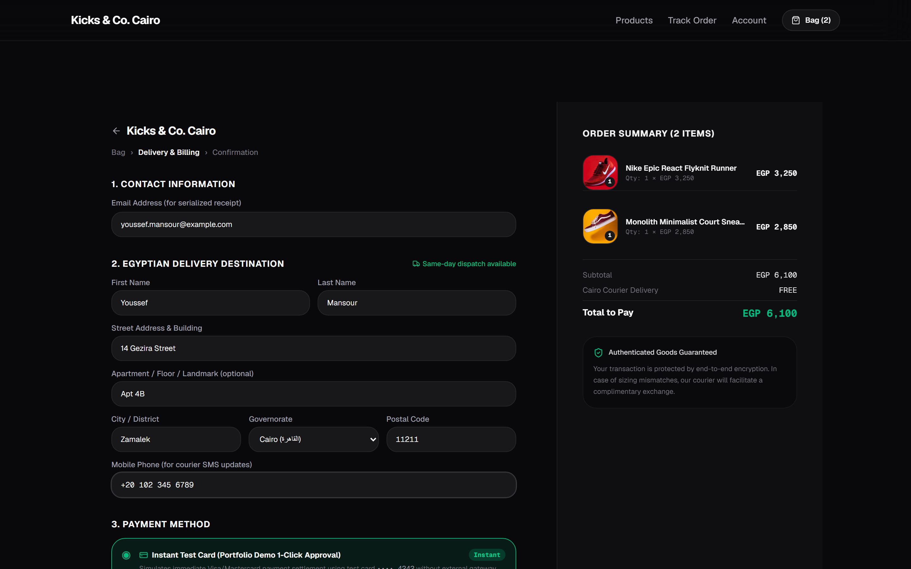</a>

**Checkout Flow** — Two-column checkout with customer contact input, Egyptian governorate delivery fields, payment method selector, and itemized order summary.

</td>
  </tr>
</table>

### Browse and Discover

<a href="docs/screenshots/07-category-listing.png">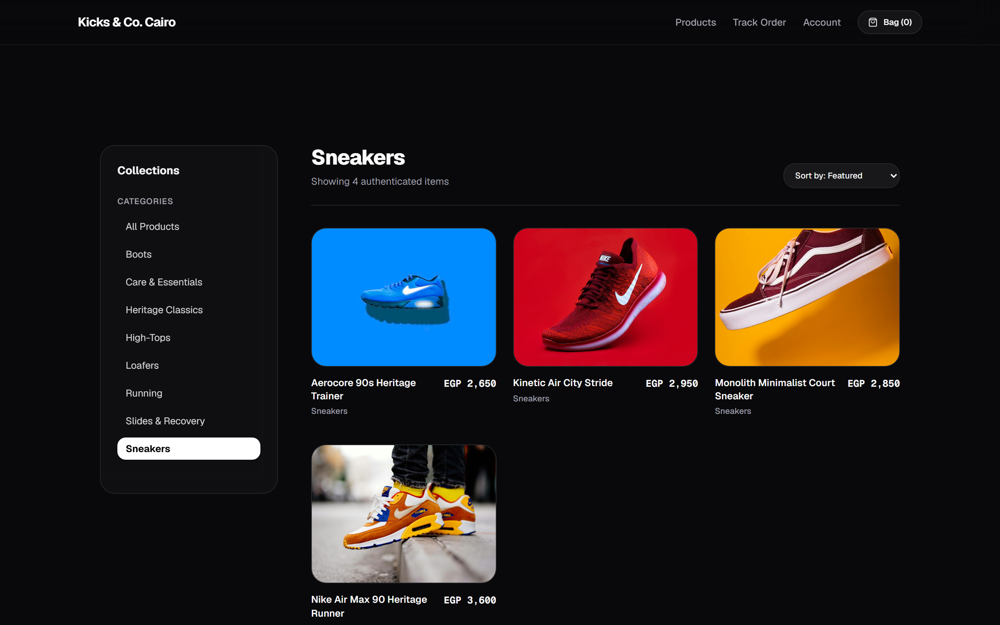</a>

**Category Catalog** — Collection route (`/collections/sneakers`) with tenant category sidebar navigation, sort dropdown, and four product cards.

### Mobile

<table>
  <tr>
    <td align="center">

<a href="docs/screenshots/14-mobile-storefront.png">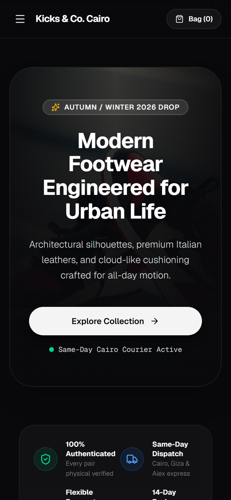</a>
<a href="docs/screenshots/15-mobile-product.png">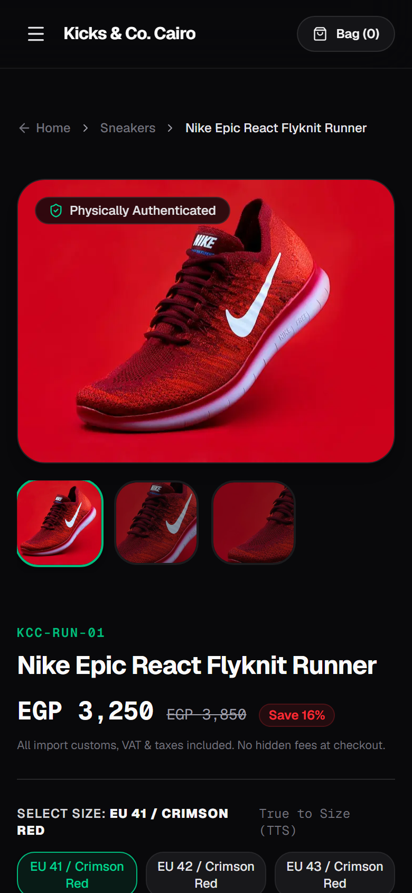</a>

Responsive storefront with a hamburger menu at mobile widths

</td>
  </tr>
</table>

### Extras

<details>
<summary>More screens</summary>

<table>
  <tr>
    <td width="50%" valign="top">

<a href="docs/screenshots/12-discounts.png">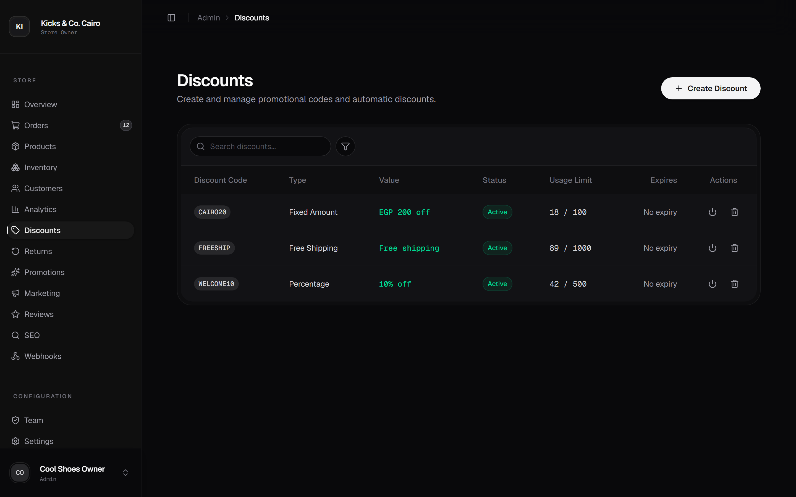</a>

**Discounts & Coupons** — Promotional code directory (`CAIRO20`, `FREESHIP`, `WELCOME10`) displaying discount type, value, active badge, and redemption counts against usage limits.

</td>
    <td width="50%" valign="top">

<a href="docs/screenshots/01b-admin-dashboard-low-stock.png">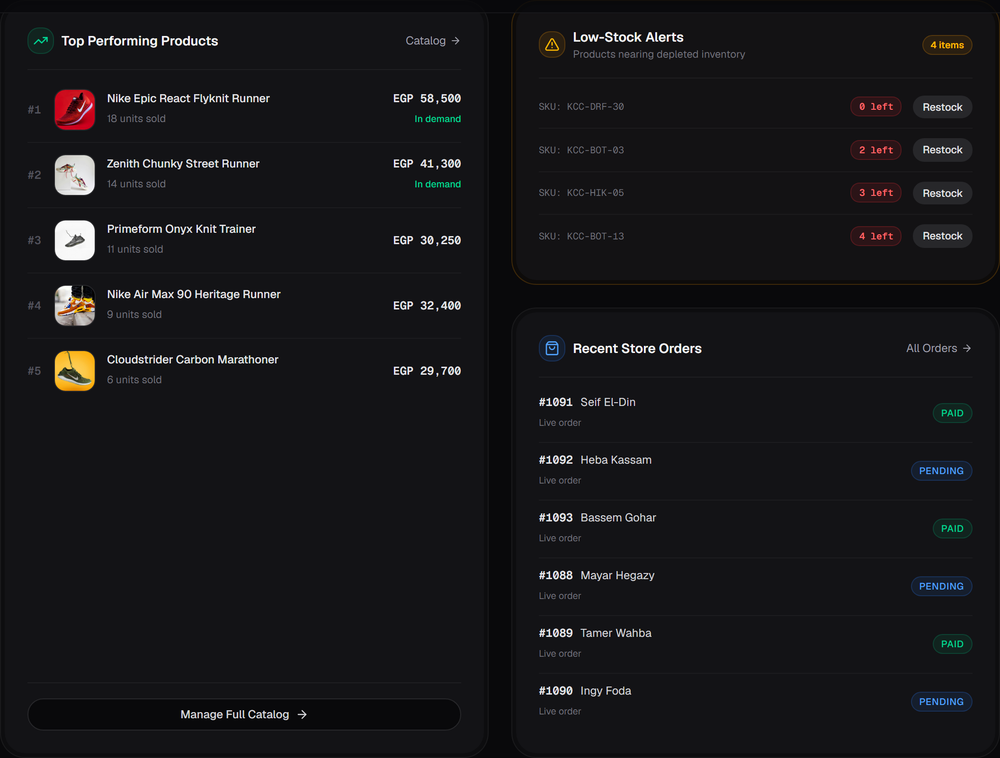</a>

**Inventory & Order Telemetry** — Dashboard cards ranking top-selling products by units sold alongside low-stock SKU warnings (`0` to `4` units left) and recent store orders.

</td>
  </tr>
  <tr>
    <td width="50%" valign="top">

<a href="docs/screenshots/05-order-detail.png">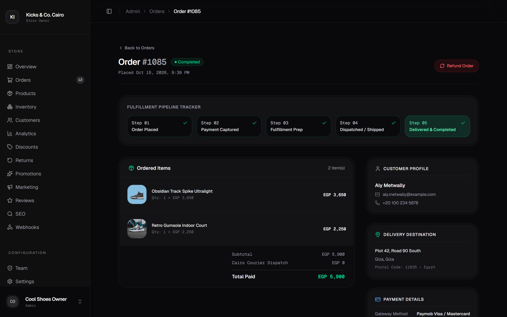</a>

**Order Detail & Fulfillment Tracker** — Five-stage fulfillment progress bar (`Order #1085`), itemized product rows with thumbnails, customer profile, and Paymob payment summary.

</td>
    <td width="50%" valign="top">

<a href="docs/screenshots/11-customers.png">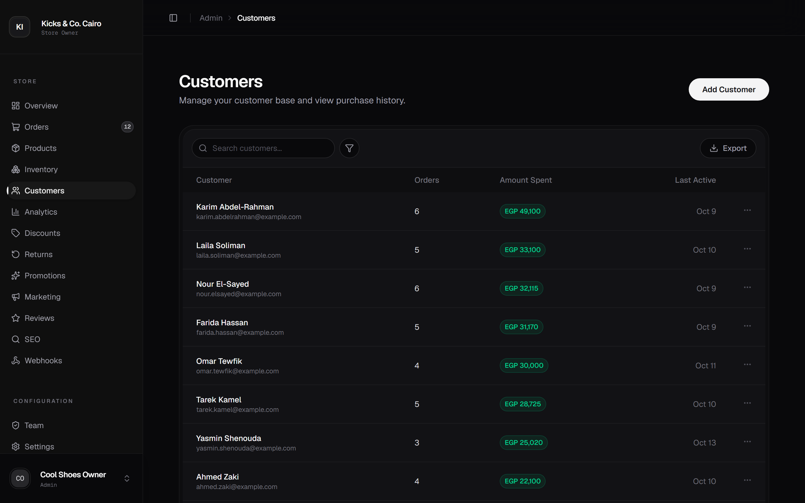</a>

**Customer Directory** — Tenant customer table showing SQL-aggregated order counts (`3` to `6` orders), cumulative spend in EGP, and last active date.

</td>
  </tr>
  <tr>
    <td width="50%" valign="top">

<a href="docs/screenshots/13-settings.png">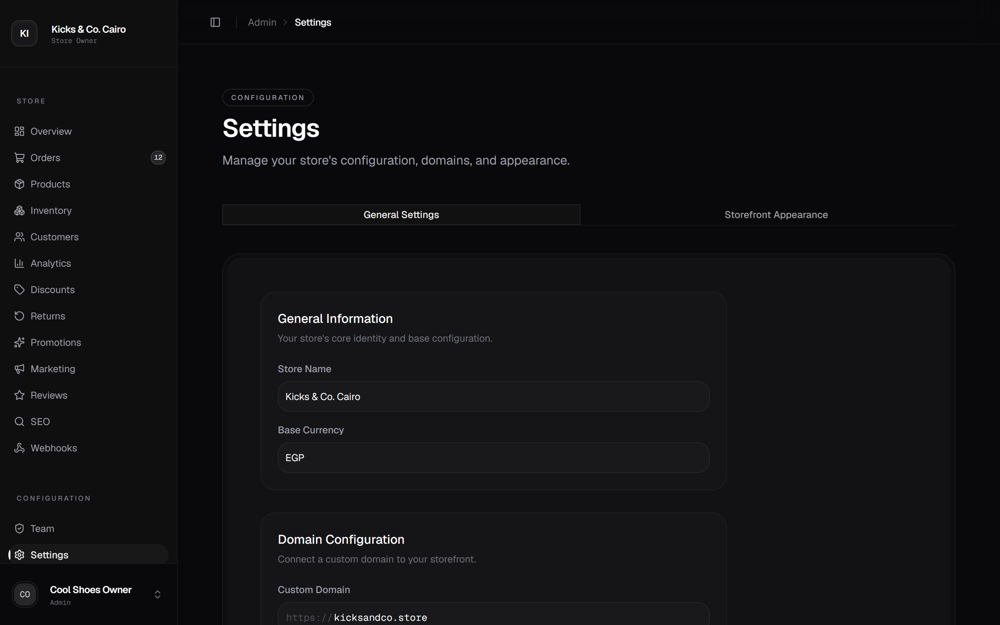</a>

**Store & Domain Settings** — Tenant configuration screen for store name, base currency (`EGP`), and custom domain binding (`https://kicksandco.store`).

</td>
    <td width="50%" valign="top">
    </td>
  </tr>
</table>

</details>

---

## Features

### Merchant Admin
- **Sales & Session Telemetry (`/admin`)**: Tracks daily and all-time revenue, order capture rate, average order value, active Redis shopper sessions, and 7-day sales volume trajectories.
- **Low-Stock Depletion Alerts**: Flags SKUs at or below their configured stock threshold (`low_stock_threshold`) with one-click restock actions on the dashboard and product tabs.
- **Catalog & Variant Matrix (`/admin/products`)**: Manages product photography, unit cost and gross margin calculations, multi-option SKU variants (size/color), category/vendor/tag classification, CSV export, and Shopify catalog import (`/api/v1/catalog/import/shopify`).
- **Order Fulfillment Pipeline (`/admin/orders`)**: Filters orders by lifecycle stage (`Pending`, `Paid`, `Processing`, `Shipped`, `Completed`, `Refunded`), tracks 5-step fulfillment progression, and initiates Paymob or manual refunds.
- **Promotional Coupon Engine (`/admin/discounts`)**: Configures fixed-amount, percentage, and free-shipping discount codes with redemption caps and expiration rules.
- **Customer Aggregation & Store Configuration (`/admin/customers`, `/admin/settings`)**: Computes per-customer order counts, lifetime spend, and last order timestamps; manages store identity, currency (`EGP`), and custom domain bindings.

### Storefront
- **Multi-Tenant Domain Resolution (`/[domain]`)**: Resolves tenant storefronts from subdomains (`{shop}.localhost:3000`) or custom domains via Cloudflare Worker headers and Next.js middleware rewrites.
- **Category & Collection Browsing (`/collections/[slug]`)**: Filters active tenant inventory by dynamic categories with featured/price sorting.
- **Interactive Product Detail (`/product/[slug]`)**: Renders multi-angle product imagery, markdown-formatted specifications, compare-at discount percentages, and variant-level stock and size selectors.
- **Persistent Slide-Over Cart Drawer**: Syncs guest (`X-Cart-Token`) and authenticated carts with Redis, calculating real-time progress toward free shipping thresholds and applying promo codes.
- **Multi-Mode Checkout (`/checkout`)**: Collects shipping destination details and supports Paymob card/wallet checkout intents, Cash on Delivery (COD), and a 1-click test card mode for local verification, backed by 15-minute Redis inventory reservation locks (`lock:inv:{variant_id}:{session_id}`).

---

## Architecture

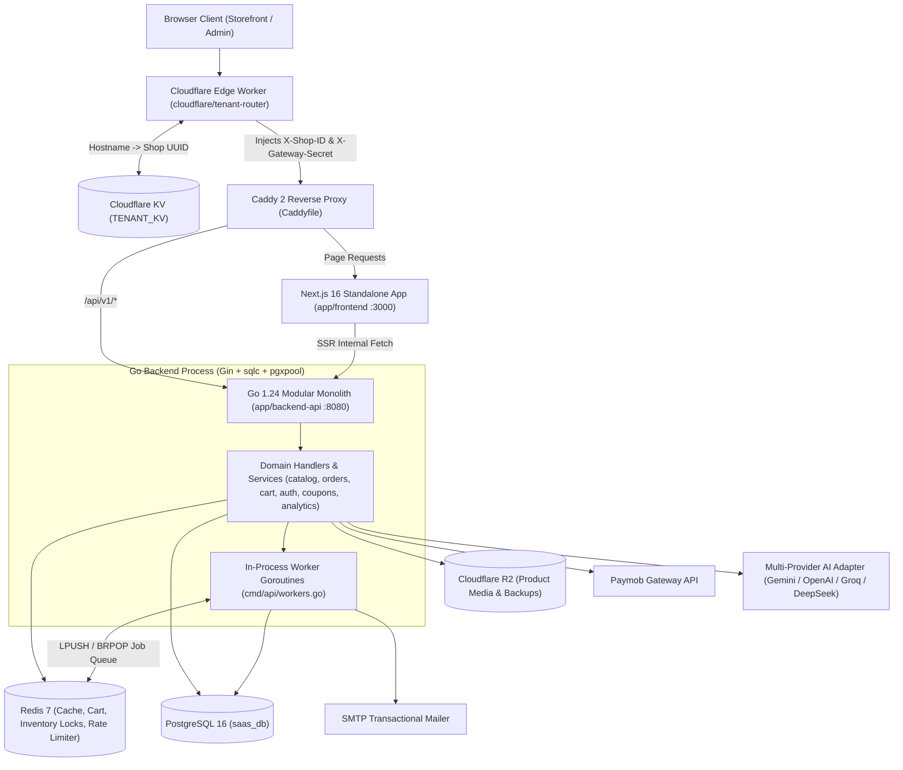

### Technical Decisions

- **Edge Tenant Resolution (`cloudflare/tenant-router`)**: Offloads custom-domain TLS termination and host-to-tenant lookup to Cloudflare Workers + KV (`TENANT_KV`). The worker injects `X-Shop-ID` and a shared `X-Gateway-Secret` header verified by Caddy, preventing header spoofing against the origin VPS.
- **Modular Go Monolith (`app/backend-api`)**: Packages 25 internal domain modules (`catalog`, `orders`, `cart`, `inventory`, `coupons`, `billing`, `analytics`, `webhooks`) into a single statically compiled Go 1.24 binary on `gcr.io/distroless/static-debian12`. Cross-domain operations execute as in-memory calls within one database transaction rather than distributed RPCs.
- **Compile-Time SQL via `sqlc` and `pgx/v5`**: Replaces runtime ORM reflection with code-generated Go types over raw SQL queries (`app/backend-api/sql/queries/`), catching schema drift at compile time and preserving explicit control over PostgreSQL 16 joins and aggregations.
- **Redis-Backed Job Queue & Inventory Locks (`internal/worker`, `internal/orders`)**: Uses native Redis `LPUSH`/`BRPOP` lists for asynchronous jobs (transactional emails, webhook delivery, PDF invoice generation) and TTL-bound keys (`lock:inv:{variant_id}:{session_id}`) to hold stock during checkout without operating a separate message broker.
- **Single-Deployment Multi-Tenant Next.js Routing (`src/middleware.ts`)**: Inspects the incoming `Host` header in Next.js middleware to serve `/admin` and `/superadmin` on the root domain while rewriting tenant subdomains and custom domains to `/[domain]/*` inside a single standalone Node 20 container.

---

## Local Development

### Prerequisites

- **Docker Engine & Docker Compose v2** (runs PostgreSQL 16, Redis 7, Go 1.24 with Air hot-reload, and Node 20)
- **Go `1.24+`** and **Node.js `20+`** (only required if running tests or services outside Docker)
- **PowerShell 7 (`pwsh`)** (optional, for the Windows `scripts/rebuild.ps1` helper)

### 1. Environment Setup

Copy `.env.example` to `.env` at the repository root:

```powershell
Copy-Item .env.example .env
```

`docker-compose.dev.yml` supplies default local credentials (`user` / `password` on database `saas_db`, Redis on `redis:6379`). Optional third-party keys (`PAYMOB_*`, `SMTP_*`, `R2_*`, `AI_*`) can be populated in `.env` if testing external integrations.

### 2. Start Services, Run Migrations, and Seed Data

**Option A — Automated PowerShell Script (Windows):**

```powershell
./scripts/rebuild.ps1 -Full
```

**Option B — Manual Docker Compose Commands (Cross-Platform):**

```powershell
# 1. Build and start PostgreSQL, Redis, Go Backend, and Next.js Frontend
docker compose -f docker-compose.dev.yml up -d --build postgres redis backend frontend

# 2. Apply SQL migrations (app/backend-api/migrations/)
docker compose -f docker-compose.dev.yml run --rm migrate

# 3. Seed baseline plans, tenants, staff accounts, and catalog items
Get-Content app/backend-api/seed.sql | docker exec -i $(docker compose -f docker-compose.dev.yml ps -q postgres) psql -U user -d saas_db
```

### 3. Local URLs & Seeded Credentials

| Service / Workspace | Local URL | Default Credentials (`seed.sql`) |
| :--- | :--- | :--- |
| **Customer Storefront (Tenant A)** | `http://coolshoes.localhost:3000` | Customer: `alice@example.com` / `password123` |
| **Customer Storefront (Tenant B)** | `http://techstore.localhost:3000` | Customer: `alice@example.com` / `password123` |
| **Merchant Admin Console** | `http://localhost:3000/admin` | Staff: `owner@coolshoes.com` / `password123` |
| **Platform Superadmin Console** | `http://localhost:3000/superadmin` | Admin: `admin@nexus-commerce.com` / `password123` |
| **Backend REST API** | `http://localhost:8080/api/v1` | Health check: `http://localhost:8080/health` |

---

## Operational Notes

- Demo data uses placeholder product photos and is not affiliated with any brand.
- Screenshots are captured from a seeded local database; no real customer data.
