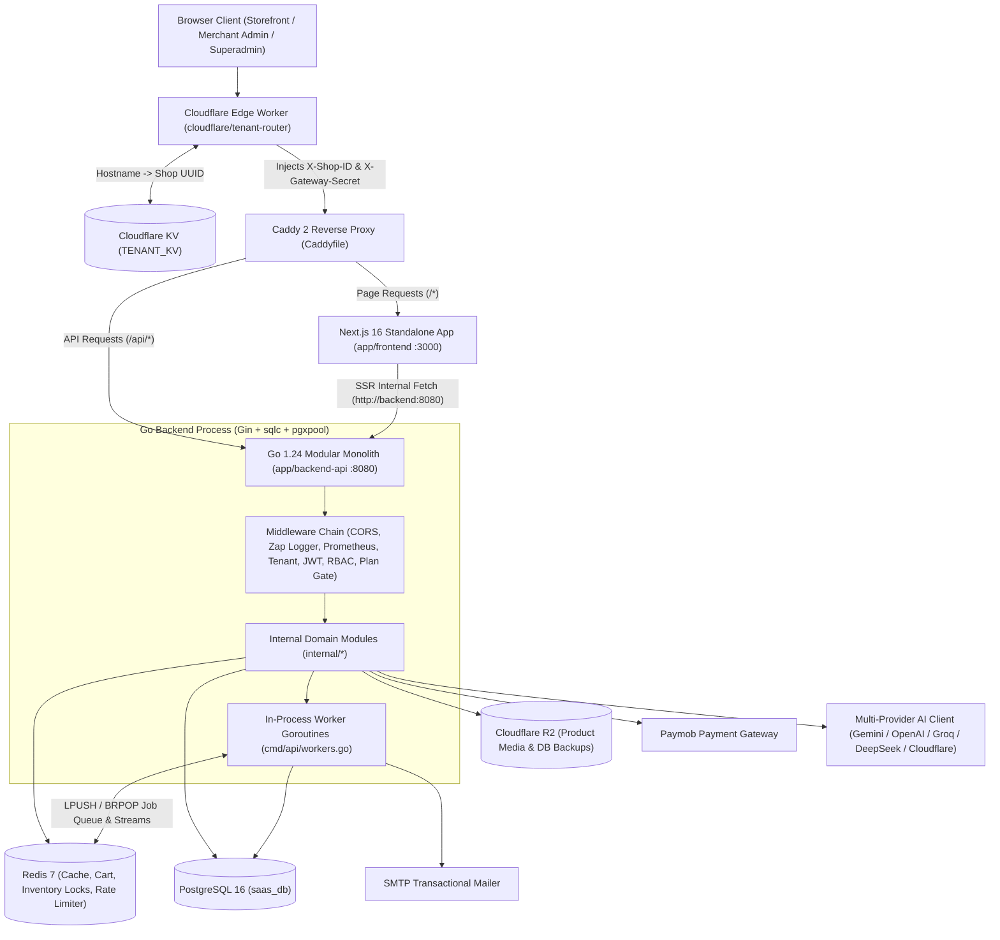

# Nexus Commerce — Engineering Handbook

Consolidates system architecture, multi-tenant edge routing, backend module boundaries, database schema and `sqlc` contracts, REST API conventions, subscription feature flags, LLM provider configuration, and the production deployment runbook.

---

## Table of Contents

1. [System Architecture](#1-system-architecture)
2. [Multi-Tenant Routing & Edge Security](#2-multi-tenant-routing--edge-security)
3. [Backend Modular Monolith (`app/backend-api`)](#3-backend-modular-monolith-appbackend-api)
4. [Data Model, Migrations & `sqlc` Workflow](#4-data-model-migrations--sqlc-workflow)
5. [Redis Subsystem: Caching, Queues & Inventory Locks](#5-redis-subsystem-caching-queues--inventory-locks)
6. [API Architecture & Security Conventions](#6-api-architecture--security-conventions)
7. [Subscription Plans, Quotas & Feature Flag Matrix](#7-subscription-plans-quotas--feature-flag-matrix)
8. [AI Subsystem & LLM Provider Configuration](#8-ai-subsystem--llm-provider-configuration)
9. [Storefront, Admin Console & Analytics Ingestion](#9-storefront-admin-console--analytics-ingestion)
10. [Infrastructure, Observability & Deployment Runbook](#10-infrastructure-observability--deployment-runbook)
11. [Architecture Decision Records (ADRs) Index](#11-architecture-decision-records-adrs-index)

---

## 1. System Architecture

Nexus Commerce couples a Cloudflare Worker edge router with a Go 1.24 modular monolith, PostgreSQL 16, Redis 7, and a standalone Next.js 16 SSR container behind Caddy 2.



### Core Architectural Invariants
- **Tenant Isolation (`shop_id`)**: Every tenant-owned record in PostgreSQL and key in Redis is scoped to a tenant UUID (`shop_id`). Tenant resolution occurs at the edge and is enforced by backend middleware and SQL query parameters.
- **Compile-Time SQL (`sqlc` + `pgx/v5`)**: SQL queries are authored in raw `.sql` files (`app/backend-api/sql/queries/`) and compiled into strongly typed Go methods (`internal/db/`).
- **In-Process Domain Calls**: Domain modules (`catalog`, `orders`, `inventory`, `coupons`, `billing`, etc.) communicate via direct Go struct/interface calls and shared PostgreSQL transactions.
- **Redis-Backed Asynchronous Processing**: Background jobs, webhook dispatches, invoice PDF generation, and domain timers run as managed goroutines inside the Go binary backed by Redis lists (`LPUSH`/`BRPOP`) and streams.

---

## 2. Multi-Tenant Routing & Edge Security

Production supports two tenant addressing modes:
1. **Platform Subdomains**: `{subdomain}.egyptcommerce.com`
2. **Custom Merchant Domains**: e.g., `www.kicksandco.store` (provisioned via Cloudflare for SaaS)

### Edge Resolution Flow (`cloudflare/tenant-router/src/index.js`)
1. Incoming HTTPS traffic terminates at the Cloudflare Worker.
2. The Worker queries Cloudflare KV (`TENANT_KV`) for the exact `hostname` (custom domain) or `subdomain:{subdomain}` for `*.egyptcommerce.com` requests.
3. When resolved, the Worker injects `X-Shop-ID: <tenant-uuid>` and `X-Gateway-Secret: <shared-secret>` into upstream request headers.
4. Requests prefixed with `/api/` route to `BACKEND_ORIGIN`; all other requests route to `FRONTEND_ORIGIN`.

### Origin Verification (`Caddyfile` & `TenantMiddleware`)
- **Caddy Layer**: In production (`Caddyfile`), Caddy inspects requests to `*.{$ROOT_DOMAIN}` and `{$ROOT_DOMAIN}` and aborts any connection missing a matching `X-Gateway-Secret` header.
- **Go Middleware Layer (`internal/shared/middleware/tenant.go`)**:
  - `TenantMiddleware(gatewaySecret)` validates `X-Gateway-Secret` (when configured) and requires a non-empty `X-Shop-ID` header, binding `shop_id` into the Gin context (`c.Set("shop_id", shopID)`).
  - `OptionalTenantMiddleware(gatewaySecret)` validates the secret if `X-Shop-ID` is present without rejecting tenant-less public requests.

> [!NOTE]
> **Local Development Routing (`docker-compose.dev.yml`)**: Local requests hit Next.js (`localhost:3000`) and the Go API (`localhost:8080`) directly without the Cloudflare Worker or Caddy. Next.js middleware (`app/frontend/src/middleware.ts`) parses `*.localhost:3000` hostnames, rewrites storefront routes to `/[domain]/*`, and resolves shop context via `GET /api/v1/storefront/shop/:domain`.

---

## 3. Backend Modular Monolith (`app/backend-api`)

The backend is a statically compiled Go 1.24 binary (`cmd/api`) wired via constructor dependency injection in `cmd/api/services.go`.

### Directory Structure

```text
app/backend-api/
├── cmd/
│   ├── api/                 # Application entrypoint (main.go, routes.go, services.go, workers.go)
│   └── migrate/             # Standalone SQL migration runner binary
├── internal/
│   ├── config/              # Viper environment configuration & production safety guards
│   ├── db/                  # Generated by sqlc (do not edit manually)
│   ├── shared/              # Cross-cutting packages (middleware, token, response, apperr, audit, pgutil)
│   ├── worker/              # Redis LPUSH/BRPOP job queue & scheduled background workers
│   └── <domain>/            # Business domain modules (handler.go, service.go, dto.go)
├── migrations/              # Sequential .up.sql and .down.sql schema migrations (000001 -> 000037)
├── sql/
│   ├── queries/             # SQL query contracts consumed by sqlc
│   └── schema/              # Declarative table definitions consumed by sqlc
├── seed.sql                 # Baseline plans, test tenants, staff users, and sample catalog
└── sqlc.yaml                # sqlc code generation configuration
```

### Internal Domain Modules

| Domain Category | Packages (`internal/*`) | Responsibilities |
| :--- | :--- | :--- |
| **Platform & Tenancy** | `admin`, `billing`, `subscriptions` | Superadmin tenant management, SaaS subscription plans (`starter`, `growth`, `scale`), feature gating, quota metering, platform invoices. |
| **Identity & Access** | `auth`, `staff` | Multi-actor JWT authentication (Platform Admin, Shop Staff, Storefront Customer), TOTP 2FA (AES-256-GCM encrypted), RBAC roles & permissions, staff invitations & audit logs. |
| **Catalog & Inventory** | `catalog`, `inventory`, `storage` | Products, multi-option SKU variants, attributes, full-text search (`tsvector`), Shopify CSV/API import, multi-warehouse inventory, bundles, R2 media uploads. |
| **Cart, Checkout & Orders** | `cart`, `orders`, `returns`, `shipping`, `addresses`, `paymob` | Redis-backed guest/customer carts, 15-min checkout inventory reservation locks, order state machine, Paymob HMAC webhooks & refunds, shipping zones, customer return workflows. |
| **Growth & Engagement** | `coupons`, `promotions`, `wishlists`, `reviews`, `socialproof`, `seo` | Fixed/percentage/free-shipping coupons, flash sales, tiered discounts, customer wishlists, moderated reviews, social proof events, SEO scoring & sitemaps. |
| **Operations & Comms** | `customers`, `support`, `notifications`, `webhooks`, `email`, `currency` | Customer directory & GDPR consent/export, helpdesk tickets & KB articles, Web Push (VAPID) + SSE + WhatsApp notifications, outbound HMAC merchant webhooks, multi-currency rate sync. |
| **Telemetry & AI** | `analytics`, `ai`, `metrics` | Redis Stream event ingestion, revenue/funnel/cohort aggregation, multi-provider LLM client, Prometheus metrics exporter (`:9091`). |

---

## 4. Data Model, Migrations & `sqlc` Workflow

### Source of Truth Rules
1. **Runtime Migrations**: `app/backend-api/migrations/*.sql`.
2. **sqlc Schema & Query Contracts**: `app/backend-api/sql/schema/*.sql` and `app/backend-api/sql/queries/*.sql`.
3. **Generated Go Access Layer**: `app/backend-api/internal/db/` (generated via `sqlc generate`; only `staff_extra.go` and `db.go` are hand-maintained).

### Core Schema Tables
- **Platform & Billing**: `plans`, `shops`, `shop_invoices`, `platform_admins`, `subscriptions`.
- **Identity & Security**: `users`, `customers`, `customer_addresses`, `shop_staff`, `shop_roles`, `invitations`, `user_secrets` (2FA), `staff_audit_log`, `audit_logs`, `consent_log` (GDPR).
- **Catalog & Inventory**: `categories`, `products` (with `search_vector` `tsvector` FTS), `product_variants`, `product_images`, `product_attributes`, warehouse & bundle inventory tables.
- **Commerce & Fulfillment**: `orders`, `order_items`, `returns`, `shipping_zones`, `coupons`, `promotions`, `saved_carts`, `shop_payment_methods`.
- **Engagement, Support & AI**: `wishlists`, `product_reviews`, `social_proof_events`, `loyalty_tiers`, `referral_config`, `support_tickets`, `support_messages`, `support_automation_rules`, `kb_articles`, `notifications`, `webhooks`, `ab_tests`, `seo_*`, `ai_config` / `ai_usage`, `analytics_events`.

### Schema & Query Update Workflow

```powershell
# 1. Add sequential migration files in app/backend-api/migrations/
# 2. Apply migrations to local PostgreSQL
docker compose -f docker-compose.dev.yml run --rm migrate

# 3. Update app/backend-api/sql/schema/ and app/backend-api/sql/queries/
# 4. Regenerate Go models and querier methods
Push-Location app/backend-api
sqlc generate
Pop-Location
```

---

## 5. Redis Subsystem: Caching, Queues & Inventory Locks

Redis 7 (`redis:7-alpine`, configured with `--appendonly yes` and `allkeys-lru` in production) handles four workloads:

### 1. Checkout Inventory Reservation Locks ([ADR 0006](adr/0006-inventory-reservation-via-redis.md))
- **Key Format**: `lock:inv:{variant_id}:{session_id}` -> `{quantity}`
- **TTL**: 15 minutes.
- **Lifecycle**: Created during `POST /api/v1/checkout/intent`. When Paymob confirms payment via webhook, PostgreSQL stock is decremented in a transaction and the Redis lock is deleted. Abandoned checkouts expire via TTL.

### 2. Asynchronous Worker Queue ([ADR 0005](adr/0005-redis-backed-custom-worker-queue.md))
Implemented in `internal/worker/worker.go` and wired in `cmd/api/workers.go`:
- Enqueues JSON-serialized job payloads via `LPUSH` and processes them across `WORKER_CONCURRENCY` (default `4`) goroutines using `BRPOP`.
- Registered Job Handlers:
  - Transactional email dispatch (`worker.EmailHandlers`)
  - Outbound merchant webhook delivery with retries (`worker.JobDispatchWebhook`)
  - Order invoice generation to R2 storage (`worker.JobGenerateInvoice`)

### 3. In-Process Background Workers (`cmd/api/workers.go`)
`startWorkers()` spawns context-aware goroutines that drain on `SIGINT`/`SIGTERM`:
- `analytics.Worker`: Consumes analytics events from Redis Streams and flushes aggregates to PostgreSQL.
- `worker.SupportAutomationWorker`: Evaluates SLA and auto-response rules on open support tickets.
- `billing.InvoiceWorker`: Generates monthly platform billing invoices and processes renewals.
- `cart.AbandonedCartWorker`: Detects inactive carts and enqueues recovery emails.
- `currency.RateWorker`: Refreshes foreign exchange rates.
- `worker.SubscriptionRenewalWorker` & `worker.LoyaltyExpiryWorker`: Processes recurring customer subscriptions and loyalty point expiration.
- `seo.Worker`: Audits catalog SEO scores and regenerates sitemaps.

### 4. Cart Persistence & Rate Limiting
- **Shopping Carts (`internal/cart`)**: Guest (`X-Cart-Token`) and authenticated customer carts are stored in Redis prior to checkout conversion.
- **IP Rate Limiting (`internal/shared/middleware`)**: Fixed-window rate limiters (e.g., 20 req/min on auth and AI endpoints) guard against credential stuffing and quota exhaustion.

---

## 6. API Architecture & Security Conventions

> [!IMPORTANT]
> **Source of Truth for API Routes**: The route table is defined in [`app/backend-api/cmd/api/routes.go`](../app/backend-api/cmd/api/routes.go) and domain handlers (`internal/<domain>/handler.go`).

### Route Mounting & Middleware Groups (`cmd/api/routes.go`)

| Route Group | Tenant Header (`X-Shop-ID`) | Authentication & Authorization | Representative Endpoints |
| :--- | :--- | :--- | :--- |
| **System Health & SEO** | Not required | Public | `GET /health`, `GET /ready`, `GET /sitemap.xml`, `GET /robots.txt` |
| **Public Storefront & Webhooks** | Not required | Public / HMAC verified | `GET /api/v1/storefront/shop/:domain`, `POST /api/v1/analytics/ingest`, Paymob callbacks, public billing plans |
| **Platform Superadmin** | Not required | `RequireAuth` + `RequirePlatformAdmin` | `/api/v1/admin/*`, `/api/v1/platform/*` (tenant provisioning, global metrics, plan management) |
| **Staff Authentication** | Not required | `RequireAuth` + `RequireStaff` + `authRL` | Staff login, registration, 2FA verification, shop selection |
| **Customer Storefront API** | **Required** (`TenantMiddleware`) | `OptionalAuth` or `RequireCustomer` | `/api/v1/cart/*`, `/api/v1/checkout/*`, customer orders, addresses, wishlists, reviews, storefront catalog |
| **Merchant Admin API** | **Required** (`TenantMiddleware`) | `RequireAuth` + `RequirePermission("<domain>.<action>")` + `RequireFeature` / `RequireQuota` | `/api/v1/catalog/*`, `/api/v1/orders/*`, `/api/v1/coupons/*`, `/api/v1/inventory/*`, `/api/v1/analytics/*`, `/api/v1/ai/*`, `/api/v1/seo/*` |

### Security & Response Conventions
- **Authentication**: Bearer JWT tokens (`Authorization: Bearer <token>`) signed with `JWT_SECRET`.
- **RBAC**: Merchant endpoints enforce domain permissions (`products.read`, `products.write`, `orders.read`, `marketing.read`, `inventory.read`, `analytics.read`, `billing.read`, `support.read`, `settings.read`).
- **Quota & Feature Enforcement**:
  - `svc.MeteringSvc.RequireQuota("products")` blocks resource creation when a tenant reaches their plan limit.
  - `svc.BillingSvc.RequireFeature("<flag_key>")` returns HTTP `403` when a tenant's active plan does not enable the requested capability.
- **Envelope Format**: JSON responses use `internal/shared/response` (`{"data": ..., "meta": ...}` for successes, structured error payloads for `4xx`/`5xx`).
- **Encryption at Rest**:
  - Merchant Paymob credentials are encrypted using AES-256-GCM with `PAYMOB_CREDENTIALS_KEY`.
  - Staff 2FA TOTP secrets are encrypted using AES-256-GCM with `TOTP_ENCRYPTION_KEY`.

---

## 7. Subscription Plans, Quotas & Feature Flag Matrix

Tenant capabilities are governed by `plans.features` (JSONB) seeded in [`app/backend-api/seed.sql`](../app/backend-api/seed.sql) and enforced by `internal/billing`.

### Plan Tiers & Resource Quotas (`seed.sql`)

| Plan Tier (`plans.name`) | Monthly Price (EGP) | Max Products | Max Staff Accounts | Max Storage | Transaction Fee |
| :--- | :---: | :---: | :---: | :---: | :---: |
| **`starter`** | 599.00 | 100 | 1 | 1,024 MB (1 GB) | 2.0% |
| **`growth`** | 999.00 | Unlimited (`-1`) | 3 | 5,120 MB (5 GB) | 1.5% |
| **`scale`** | 1,499.00 | Unlimited (`-1`) | Unlimited (`-1`) | 20,480 MB (20 GB) | 1.0% |

### Feature Flag Matrix by Plan

| Category | Feature Flag Key | `starter` | `growth` | `scale` |
| :--- | :--- | :---: | :---: | :---: |
| **Core Platform** | `custom_domain`, `coupons`, `shipping_zones`, `localization`, `pwa` | ✅ | ✅ | ✅ |
| **Core Platform** | `webhooks` | ❌ | ✅ | ✅ |
| **Core Platform** | `support_automation`, `priority_support` | ❌ | ❌ | ✅ |
| **Notifications** | `notifications_in_app` | ✅ | ✅ | ✅ |
| **Notifications** | `notifications_push`, `notifications_sse` | ❌ | ✅ | ✅ |
| **Catalog & Inventory** | `inventory_bundles`, `pre_orders`, `flash_sales`, `tiered_discounts`, `multi_currency` | ❌ | ✅ | ✅ |
| **Catalog & Inventory** | `multi_warehouse`, `reorder_automation` | ❌ | ❌ | ✅ |
| **Customer & Loyalty** | `wishlists`, `product_reviews` | ✅ | ✅ | ✅ |
| **Customer & Loyalty** | `review_moderation`, `social_proof`, `abandoned_cart_recovery` | ❌ | ✅ | ✅ |
| **Customer & Loyalty** | `loyalty_program`, `referral_program` | ❌ | ❌ | ✅ |
| **SEO** | `seo_basic` | ✅ | ✅ | ✅ |
| **SEO** | `seo_scoring`, `seo_redirects` | ❌ | ✅ | ✅ |
| **SEO** | `seo_advanced`, `seo_search_console` | ❌ | ❌ | ✅ |
| **Analytics** | `core_analytics` | ✅ | ✅ | ✅ |
| **Analytics** | `realtime_analytics`, `standard_analytics`, `analytics_export` | ❌ | ✅ | ✅ |
| **Analytics** | `advanced_analytics`, `analytics_alerts`, `analytics_api_access` | ❌ | ❌ | ✅ |
| **AI Capabilities** | `ai_text`, `ai_seo`, `ai_translate`, `ai_email`, `ai_engine` | ❌ | ✅ | ✅ |
| **AI Capabilities** | `ai_reports`, `ai_vision`, `ai_forecasting`, `ai_churn_scoring` | ❌ | ❌ | ✅ |

---

## 8. AI Subsystem & LLM Provider Configuration

The `app/backend-api/internal/ai/` package provides merchant text generation, localization, SEO metadata generation, and token metering under `/api/v1/ai` (60-second request timeout, IP rate-limited).

### Multi-Provider LLM Adapter (`cmd/api/services.go`)
- Supports primary and fallback provider chains configured via `AI_PRIMARY_PROVIDER`, `AI_PRIMARY_API_KEY`, `AI_PRIMARY_MODEL`, and `AI_FALLBACK_*`.
- Supported providers: `gemini`, `openai`, `groq`, `deepseek`, `cloudflare`.
- Prompt templates are loaded at startup from `internal/ai/prompts` (`AI_PROMPTS_DIR`).
- When provider keys are unset in local development, endpoints return `503` or deterministic template copy (`/api/v1/ai/generate-description`).

### Mounted AI Endpoints (`internal/ai/handler.go`)
- `POST /api/v1/ai/products/:id/description` (Gate: `ai_text`) — Generates product descriptions from product metadata.
- `POST /api/v1/ai/products/:id/seo-meta` (Gate: `ai_seo`) — Generates SEO meta titles and descriptions.
- `POST /api/v1/ai/products/:id/translate` (Gate: `ai_translate`) — Translates product titles and descriptions into target languages.
- `POST /api/v1/ai/products/:id/titles` (Gate: `ai_text`) — Generates alternative product titles.
- `POST /api/v1/ai/content/quality` (Gate: `ai_text`) — Evaluates copy readability and SEO score.
- `POST /api/v1/ai/email/copy` (Gate: `ai_email`) — Generates lifecycle and promotional email copy.
- `POST /api/v1/ai/generate-description` — Synchronous product description endpoint for the catalog editor with template fallback.
- `GET /api/v1/ai/usage` — Returns current-month token and request consumption (`CountAIUsage`) for the tenant.

---

## 9. Storefront, Admin Console & Analytics Ingestion

### Single-Deployment Next.js 16 Architecture (`app/frontend`)
Per [ADR 0007](adr/0007-storefront-standalone-nextjs.md), the Next.js 16 application builds with `output: "standalone"` and runs inside a single Node 20 container (`frontend:3000`).

`app/frontend/src/middleware.ts` inspects the `Host` header on non-asset requests:
1. **Platform & Merchant Admin Routes** (`localhost:3000`, `egyptcommerce.com`, `admin.egyptcommerce.com`, `app.egyptcommerce.com`):
   - Serves `/admin/*` (Merchant Operations Console) and `/superadmin/*` (Platform Console).
   - Verifies `admin_access_token` cookie presence on `/admin/*` routes, redirecting unauthenticated sessions to `/admin/login`.
2. **Tenant Storefront Routes** (`{shop}.localhost:3000`, `{shop}.egyptcommerce.com`, or custom domains):
   - Rewrites the URL path to `/{hostname}{pathname}` (`src/app/[domain]/*`) for SSR storefront rendering, category filtering (`/collections/[slug]`), product pages (`/product/[id]`), cart drawer, and checkout (`/checkout`).

### Analytics Ingestion ([ADR 0008](adr/0008-analytics-js-beacon.md))
- Storefront pages emit session and conversion events to `POST /api/v1/analytics/ingest`, which writes to Redis Streams for background aggregation into PostgreSQL.

---

## 10. Infrastructure, Observability & Deployment Runbook

### Environment Profiles

| Profile | Compose File | Services Included | Key Characteristics |
| :--- | :--- | :--- | :--- |
| **Local Dev** | `docker-compose.dev.yml` | `postgres`, `redis`, `backend`, `frontend`, `migrate` | Air reload for Go (`:8080`), Next.js dev server (`:3000`), exposed DB (`:5432`) & Redis (`:6379`) ports. |
| **Production** | `docker-compose.prod.yml` | `caddy`, `backend`, `frontend`, `postgres`, `redis`, `migrate`, `backup`, `prometheus`, `loki`, `promtail`, `grafana`, `portainer` | Container memory limits, distroless `nonroot` backend image, custom `postgresql.conf`, Redis AOF + password, daily S3/R2 backups. |
| **Staging** | On-Demand ([ADR 0009](adr/0009-low-opex-staging-environment.md)) | Reduced-memory Compose stack | Hourly-billed Hetzner CX11 instance booted during third-party webhook and migration verification. |

### Production Startup Safety Guards (`internal/config/config.go`)
When `ENVIRONMENT=production`, the Go binary aborts startup (`log.Fatal`) if any of the following invariants fail:
1. `JWT_SECRET` is empty or set to `"dev-secret-change-in-production"`.
2. `PAYMOB_CREDENTIALS_KEY` is empty.
3. `PAYMOB_HMAC_SECRET` is empty.
4. `GATEWAY_SECRET` is empty.

### Production Deployment Runbook

#### Step 1: Cloudflare Edge & R2 Setup
1. Deploy `cloudflare/tenant-router/src/index.js` to Cloudflare Workers.
2. Bind KV namespace `TENANT_KV` (`<custom_domain> -> <shop_uuid>` and `subdomain:<slug> -> <shop_uuid>`).
3. Configure Worker environment variables: `BACKEND_ORIGIN`, `FRONTEND_ORIGIN`, `GATEWAY_SECRET` (`openssl rand -hex 32`).
4. Route `*.<ROOT_DOMAIN>` and Cloudflare for SaaS custom hostnames to the Worker.
5. Create a Cloudflare R2 bucket for product media and PostgreSQL backups (`R2_ACCOUNT_ID`, `R2_ACCESS_KEY`, `R2_SECRET_KEY`, `R2_BUCKET`).

#### Step 2: VPS Provisioning (Ubuntu 24.04 LTS)
1. Provision a Linux host (4 GB RAM minimum; 8–16 GB recommended with observability containers).
2. Install Docker Engine and the Docker Compose plugin.
3. Configure firewall rules (UFW):
   ```bash
   ufw allow 22/tcp
   ufw allow 80/tcp
   ufw allow 443/tcp
   ufw enable
   ```

#### Step 3: Configuration & Secret Population
```bash
git clone <repo-url> /opt/nexus-commerce
cd /opt/nexus-commerce
cp .env.example .env
```
Populate `.env` with production secrets (`JWT_SECRET`, `GATEWAY_SECRET`, `PAYMOB_CREDENTIALS_KEY`, `PAYMOB_HMAC_SECRET`, `DB_PASSWORD`, `REDIS_PASSWORD`, `TOTP_ENCRYPTION_KEY`, `GRAFANA_PASSWORD`, `R2_*`).

#### Step 4: Boot Stack & Run Migrations
```bash
docker compose -f docker-compose.prod.yml up -d --build
docker compose -f docker-compose.prod.yml run --rm migrate
docker compose -f docker-compose.prod.yml ps
```

#### Step 5: Post-Deployment Verification
1. **Gateway Secret Verification**:
   ```bash
   curl -i -H "X-Shop-ID: 11111111-aaaa-bbbb-cccc-000000000001" http://<vps-ip>/api/v1/health
   ```
   Confirm Caddy rejects requests missing `X-Gateway-Secret`.
2. **Database Backups**:
   - The `backup` container (`prodrigestivill/postgres-backup-s3:16`) runs `@daily` (retaining 7 daily, 4 weekly, and 6 monthly snapshots under `s3://<R2_BUCKET>/db-backups`).
   - Check logs: `docker compose -f docker-compose.prod.yml logs backup`.
3. **Observability**:
   - **Grafana (`https://monitor.<ROOT_DOMAIN>`)**: Pre-provisioned with Loki (Promtail container logs) and Prometheus (`backend:9091` metrics and `pgxpool` stats).
   - **Portainer (`https://ops.<ROOT_DOMAIN>`)**: Container management UI behind Caddy `basic_auth`.

---

## 11. Architecture Decision Records (ADRs) Index

| ADR | Decision Summary | Status |
| :--- | :--- | :---: |
| [ADR 0001](adr/0001-record-architecture-decisions.md) | Record Architecture Decisions using Nygard ADR format | Accepted |
| [ADR 0002](adr/0002-edge-routing-via-cloudflare-workers.md) | Edge routing and custom-domain TLS via Cloudflare Workers and KV | Accepted |
| [ADR 0003](adr/0003-modular-monolith-over-microservices.md) | Modular Go monolith (`internal/*`) over distributed microservices | Accepted |
| [ADR 0004](adr/0004-sqlc-for-type-safe-database-access.md) | Compile-time SQL generation via `sqlc` and `pgx/v5` | Accepted |
| [ADR 0005](adr/0005-redis-backed-custom-worker-queue.md) | Redis `LPUSH`/`BRPOP` worker queue for background jobs | Accepted |
| [ADR 0006](adr/0006-inventory-reservation-via-redis.md) | 15-minute Redis TTL keys (`lock:inv:{variant_id}:{session_id}`) for checkout stock locks | Accepted |
| [ADR 0007](adr/0007-storefront-standalone-nextjs.md) | Standalone Next.js container behind Cloudflare edge cache | Accepted |
| [ADR 0008](adr/0008-analytics-js-beacon.md) | First-party analytics beacon ingestion via Redis Streams | Accepted |
| [ADR 0009](adr/0009-low-opex-staging-environment.md) | On-demand hourly Hetzner instance for webhook staging | Accepted |